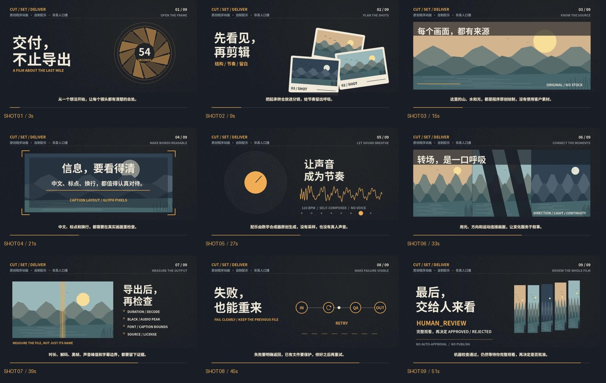
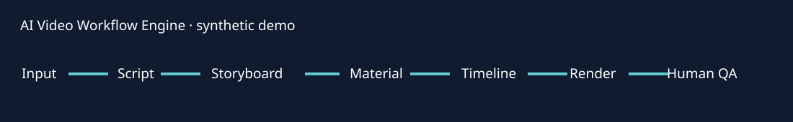
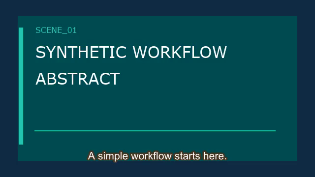
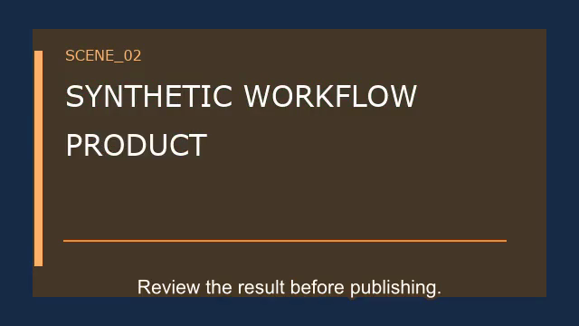

# AI Video Workflow Engine

为需要重复导出和交接视频的内容团队提供一条可追溯链路：素材清单 → 时间轴与字幕 → 实际渲染 → 媒体检查 → 带校验清单的交付包。我的工作集中在流程编排、失败处理、FFmpeg 集成和验收记录。

[播放 54 秒原创动画](examples/original_54s/sample.mp4) · [样片源码、素材与复现](examples/original_54s/README.md) · [生成与校验完整交付包](docs/DELIVERY_BUNDLES.md)


**A reproducible video-workflow engine from asset checks to a real FFmpeg render and human QA gate.** It solves the handoff problem where a file exists but the inputs, failure state or approval are unclear.

**LOCAL WORKFLOW / 54s USER-APPROVED ANIMATION** · [Watch the original animation](examples/original_54s/sample.mp4) · [Case study](docs/case-study.md) · [Project contributions](docs/resume-bullets.md) · [Interview notes](docs/interview-notes.md)

[](https://github.com/zhouey314-cloud/ai-video-workflow-engine/actions/workflows/ci.yml)



Independent clean-room framework for synthetic video production. No company pipeline source, customer media, voice data, internal prompt or paid provider call is included.



## Source installation and quick start

Requirements: Python 3.10+, FFmpeg and ffprobe. The original-animation generator also needs the pinned Pillow dependency and an available licensed CJK font. From a fresh directory, use the source snapshot verified on 2026-10-30:

```bash
git clone https://github.com/zhouey314-cloud/ai-video-workflow-engine.git
cd ai-video-workflow-engine
git checkout --detach 367badd7c3ed2314ec1014964fb8ed3931dc019e
python3 -m venv .venv
. .venv/bin/activate
python -m pip install -r examples/original_54s/requirements.txt
ffmpeg -version
ffprobe -version
python -m video_workflow.cli --help
```

The commands below run from that checkout. This is a source workflow; the historical GitHub `v1.0.0` tag is not a download of current `main`. The source package metadata remains the legacy `0.1.0`; this documentation does not create a new version or Release.

### Produce a complete task bundle

```bash
mkdir -p output
python -m video_workflow.cli --provider ffmpeg --bundle-dir output/job-001 --output output/job-001.receipt.json
python -m video_workflow.cli --verify-bundle output/job-001
```

Choose a new bundle directory for every task. The bundle contains MP4, SRT, ASS, timeline, preview, QA and a manifest with input/output hashes. Creation publishes only a mechanically checked complete directory; verification rejects missing, changed, unsafe or unlisted files. See [bundle commands, failure behavior and review limits](docs/DELIVERY_BUNDLES.md). A successful run reaches `HUMAN_REVIEW`; it does not inherit the old sample's approval.

### Reproduce the 54-second original animation

Set `VIDEO_FONT` to an existing licensed CJK font. For example, Debian/Ubuntu's `fonts-noto-cjk` package supplies `/usr/share/fonts/opentype/noto/NotoSansCJK-Regular.ttc`; select the actual font path on other systems.

```bash
VIDEO_FONT=/path/to/NotoSansCJK-Regular.ttc
python examples/original_54s/generate.py --output output/original54 --font "$VIDEO_FONT"
python -m video_workflow.cli --provider ffmpeg --storyboard output/original54/storyboard.json --assets output/original54/assets.json --font "$VIDEO_FONT" --bundle-dir output/original54-delivery --output output/original54.receipt.json
python -m video_workflow.cli --verify-bundle output/original54-delivery
```

These are new outputs, subject to fresh human review. The generator, asset rights, sample hash and CI's shorter integration fixture are documented in the [sample reproduction guide](examples/original_54s/README.md).

### Small compatibility fixture

The six-second fixture remains useful for checking the FFmpeg path before the complete animation. The default mock command `python -m video_workflow.cli` writes workflow JSON without real media; the real synthetic render is:

```bash
mkdir -p output
python -m video_workflow.cli --provider ffmpeg --media-output output/compat-fixture.mp4 --output output/compat-fixture.qa.json
```

This walks synthetic input → storyboard → asset-tag retrieval → timeline → two distinct title-card shots → burned test subtitles + generated tone → render → ffprobe QA → human-review gate. The command writes a fresh local fixture under `output/`; committed examples remain available for comparison: [6-second synthetic MP4](examples/demo-output.mp4) (72 KB), [opening frame](examples/demo-output.png), [closing frame](examples/demo-frame-2.png), [captions](examples/demo-output.srt), [timeline](examples/demo-output.timeline.json) and [QA report](examples/demo-qa.json). To inspect the new closing frame: `ffmpeg -ss 4 -i output/compat-fixture.mp4 -frames:v 1 output/compat-frame-2.png`. `--provider external` remains `NOT_CONFIGURED` and fails closed.

The CLI writes the workflow JSON report to `--output` and stdout before exiting. Exit code `0` means mechanical QA passed and the workflow reached `HUMAN_REVIEW` (or `APPROVED` if supplied by the workflow); pending human review is a successful CLI run, not human approval. Exit code `1` means the workflow failed or stopped with a material `GAP`. Use the JSON `state`, `failures`, and `events` to diagnose the result.





## Original 54-second sample

[Watch Cut / Set / Deliver](examples/original_54s/sample.mp4) · [reproduce and license](examples/original_54s/README.md) · [actual frame contact sheet](examples/original_54s/contact-sheet.jpg) · [mechanical QA](examples/original_54s/sample.qa.json) · [asset provenance](examples/original_54s/ASSET_MANIFEST.json). Nine independently animated scenes use original procedural scenery, moving paper storyboards, an aperture, actual score waveform, transitions, a QA scan and recovery graphics. The original 120-BPM mathematical score contains no recording or voice. The existing FFmpeg provider consumes these SELF video assets and soundtrack through editable generated storyboard/asset JSON, burns Chinese captions and keeps the human-review gate. The 54.000-second local H264/AAC render is 1280×720 at 24fps, with a measured −7.8dBFS sample peak, full decode and no detected black interval >=0.30s. This is program animation, not a customer video or human talking head. The user approved these exact bytes on 2026-10-21 for portfolio display; [the independent human-review record](examples/original_54s/human-review.json) binds that approval to SHA256 `0a7f73e9a5a014a352aa5f27a2852b39e558546ccc38f93016785cf2fba0e1a9`. The original machine QA remains `HUMAN_REVIEW`; future edits/renders need fresh review. CI runs a 4.5-second integration fixture, not this complete 54-second rendering or human review.

## Problem, architecture and features

Input → Script → Persona/Grounding → Storyboard → licensed synthetic material retrieval → gap detection → optional generation request → timeline plan → render adapter → QA → human review. The implementation models each state, validates a storyboard, checks license and synthetic tags, records failures, enforces a zero dollar budget and requires a named human to approve. See [architecture](docs/architecture.md), [sample storyboard](examples/storyboard.json) and [sample report](examples/sample-report.json).

## Verification and boundaries

The suite covers workflow state, missing material, real FFmpeg rendering, media QA, provider configuration, review gates and complete delivery bundles. Regressions include special-character paths, invalid-font failure without overwriting existing media, recovery after a blocked destination, dense Chinese captions, black/clipped media, manifest tampering and failed-job cleanup. A hash-binding check protects the exact reviewed animation and preserves its historical machine state. Short original-sample integrations encode all nine scenes in 4.5 seconds; they do not replace the full 54-second artifact or its human review.

After installing the dependency shown above, run `python -m unittest discover -s tests -v`. The [2026-10-30 CI for source `367badd`](https://github.com/zhouey314-cloud/ai-video-workflow-engine/actions/runs/40997957439) passed 56 tests on Linux with FFmpeg and CJK fonts installed. That is a fixed execution record, not a model-quality score or a promise about future source revisions.

MP4 QA now decodes the complete file, checks black intervals of at least 0.30 seconds, measures sample audio peak (limit −0.5 dBFS), records mean volume and verifies expected resolution/duration/audio. Subtitles use a private fixed-name ASS/font workspace; user paths never enter FFmpeg filter syntax. A separate render of the identical subtitle layer measures actual libass glyph pixel bounds at 2 fps, including wrapping and missing-glyph diagnostics. The 2 fps check is temporal sampling, not every-frame coverage. This measures subtitle-layer geometry, not readability or full-frame visual quality. Audio uses a sample peak, not a true-peak measurement. Black intervals shorter than 0.30 seconds are outside this detector gate. `--font /path/to/font.ttf` selects an available local font; `--storyboard` and `--assets` choose explicit input files. Missing/invalid input produces a nonzero JSON failure. Over-dense captions are rejected rather than truncated. FFmpeg failures preserve an existing MP4; generated sidecars are promoted only after FFmpeg completes.

`HUMAN_REVIEW` means mechanical QA passed, not video quality approval. The committed six-second MP4 was visually spot-checked at opening/closing frames; it has not been approved by an external reviewer. There is no AI model eval or paid video API. All examples are `synthetic_unverified`; real footage and publishing are outside scope. Font files are not bundled; preserve any selected font's license. See [resume bullets](docs/resume-bullets.md) and [interview notes](docs/interview-notes.md).

## Maintenance and release status

The current source metadata is the legacy `0.1.0` in `pyproject.toml`; GitHub `v1.0.0` is a historical demo snapshot, not a package version for current `main`. Use the checked-out source and Quick Start commands above for the current workflow. This documentation update creates no new Release. The next public release must use a unique version greater than `1.0.0` and align source metadata, tag and tested artifacts; old tags and downloads remain intact. See the [capability roadmap](ROADMAP.md), [changelog](CHANGELOG.md), [contribution guide](CONTRIBUTING.md), and [release checklist](docs/releases/RELEASE_CHECKLIST.md).

MIT. See [LICENSE](LICENSE).
