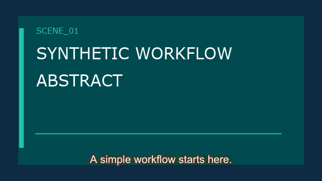
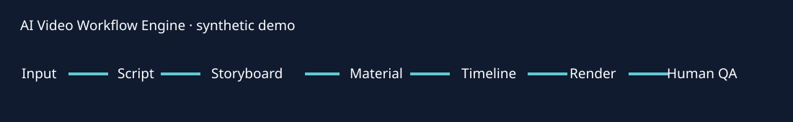
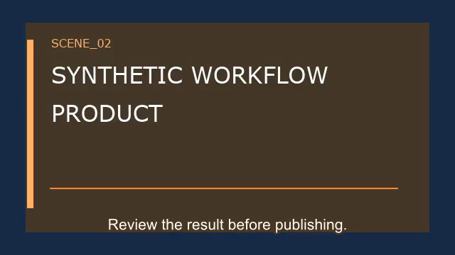

# AI Video Workflow Engine

**A reproducible video-workflow engine from asset checks to a real FFmpeg render and human QA gate.** It solves the handoff problem where a file exists but the inputs, failure state or approval are unclear.

**OFFLINE_ENGINEERING_DEMO / 54s USER-APPROVED SAMPLE** · [Watch 54-second original animation](examples/original_54s/sample.mp4) · [Six-second compatibility fixture](examples/demo-output.mp4) · [Case study](docs/case-study.md) · [Resume bullets](docs/resume-bullets.md) · [Interview notes](docs/interview-notes.md)

[](https://github.com/zhouey314-cloud/ai-video-workflow-engine/actions/workflows/ci.yml)



Independent clean-room framework for synthetic video production. No company pipeline source, customer media, voice data, internal prompt or paid provider call is included.



## Demo and quick start

Python 3.10+: `python3 -m unittest discover -s tests -v`; `python3 -m video_workflow.cli`. The mock run writes `output/demo.json` and `output/report.json`. The real synthetic FFmpeg run:

```bash
python3 -m video_workflow.cli --provider ffmpeg --media-output examples/demo-output.mp4 --output examples/demo-qa.json
```

This walks synthetic input → storyboard → asset-tag retrieval → timeline → two distinct title-card shots → burned test subtitles + generated tone → render → ffprobe QA → human-review gate. [Watch the 6-second synthetic MP4](examples/demo-output.mp4) (72 KB). [Opening frame](examples/demo-output.png) · [closing frame](examples/demo-frame-2.png) · [captions](examples/demo-output.srt) · [timeline](examples/demo-output.timeline.json) · [QA report](examples/demo-qa.json). To reproduce the closing frame: `ffmpeg -ss 4 -i examples/demo-output.mp4 -frames:v 1 examples/demo-frame-2.png`. `--provider external` remains `NOT_CONFIGURED` and fails closed.

The CLI writes the workflow JSON report to `--output` and stdout before exiting. Exit code `0` means mechanical QA passed and the workflow reached `HUMAN_REVIEW` (or `APPROVED` if supplied by the workflow); pending human review is a successful CLI run, not human approval. Exit code `1` means the workflow failed or stopped with a material `GAP`. Use the JSON `state`, `failures`, and `events` to diagnose the result.




## Original 54-second sample

[Watch Cut / Set / Deliver](examples/original_54s/sample.mp4) · [reproduce and license](examples/original_54s/README.md) · [actual frame contact sheet](examples/original_54s/contact-sheet.jpg) · [mechanical QA](examples/original_54s/sample.qa.json) · [asset provenance](examples/original_54s/ASSET_MANIFEST.json). Nine independently animated scenes use original procedural scenery, moving paper storyboards, an aperture, actual score waveform, transitions, a QA scan and recovery graphics. The original 120-BPM mathematical score contains no recording or voice. The existing FFmpeg provider consumes these SELF video assets and soundtrack through editable generated storyboard/asset JSON, burns Chinese captions and keeps the human-review gate. The 54.000-second local H264/AAC render is 1280×720 at 24fps, with a measured −7.8dBFS sample peak, full decode and no detected black interval >=0.30s. This is program animation, not a customer video or human talking head. The user approved these exact bytes on 2026-10-21 for portfolio display; [the independent human-review record](examples/original_54s/human-review.json) binds that approval to SHA256 `0a7f73e9a5a014a352aa5f27a2852b39e558546ccc38f93016785cf2fba0e1a9`. The original machine QA remains `HUMAN_REVIEW`; future edits/renders need fresh review. CI runs a 4.5-second integration fixture, not this complete 54-second rendering or human review.

## Problem, architecture and features

Input → Script → Persona/Grounding → Storyboard → licensed synthetic material retrieval → gap detection → optional generation request → timeline plan → render adapter → QA → human review. The implementation models each state, validates a storyboard, checks license and synthetic tags, records failures, enforces a zero dollar budget and requires a named human to approve. See [architecture](docs/architecture.md), [sample storyboard](examples/storyboard.json) and [sample report](examples/sample-report.json).

## Verification and boundaries

47 tests cover state, retrieval, missing material, real FFmpeg render, media stream/duration QA, provider configuration and review gates. Five delivery regressions add special-character output paths, explicit invalid-font failure without overwriting an existing artifact, recovery after a blocked destination, long Chinese captions and black/clipped media rejection. Existing CLI success/failure/GAP exit behavior is retained. One stdlib hash-binding check protects the exact user-reviewed artifact and preserves its historical machine state. Five additional original-sample integration cases use real 4.5-second encodes of all nine scenes, checking licensed audio/video input, missing material, dense-caption rejection and missing-glyph failure. Install the optional sample dependency before running all 47 tests: `python -m pip install -r examples/original_54s/requirements.txt`.

MP4 QA now decodes the complete file, checks black intervals of at least 0.30 seconds, measures sample audio peak (limit −0.5 dBFS), records mean volume and verifies expected resolution/duration/audio. Subtitles use a private fixed-name ASS/font workspace; user paths never enter FFmpeg filter syntax. A separate render of the identical subtitle layer measures actual libass glyph pixel bounds at 2 fps, including wrapping and missing-glyph diagnostics. The 2 fps check is temporal sampling, not every-frame coverage. This measures subtitle-layer geometry, not readability or full-frame visual quality. Audio uses a sample peak, not a true-peak measurement. Black intervals shorter than 0.30 seconds are outside this detector gate. `--font /path/to/font.ttf` selects an available local font; `--storyboard` and `--assets` choose explicit input files. Missing/invalid input produces a nonzero JSON failure. Over-dense captions are rejected rather than truncated. FFmpeg failures preserve an existing MP4; generated sidecars are promoted only after FFmpeg completes.

`HUMAN_REVIEW` means mechanical QA passed, not video quality approval. The committed six-second MP4 was visually spot-checked at opening/closing frames; it has not been approved by an external reviewer. There is no AI model eval or paid video API. All examples are `synthetic_unverified`; real footage and publishing are outside scope. Font files are not bundled; preserve any selected font's license. See [resume bullets](docs/resume-bullets.md) and [interview notes](docs/interview-notes.md).

## Maintenance and release status

The current source metadata is `0.1.0` in `pyproject.toml`. A historical GitHub `v1.0.0` demo Release exists; it does not establish production maturity, and no new version is proposed until that numbering conflict is resolved. See the [capability roadmap](ROADMAP.md), [changelog](CHANGELOG.md), [contribution guide](CONTRIBUTING.md), and [release checklist](docs/releases/RELEASE_CHECKLIST.md). New Release publication requires a separate decision.

MIT. See [LICENSE](LICENSE).
